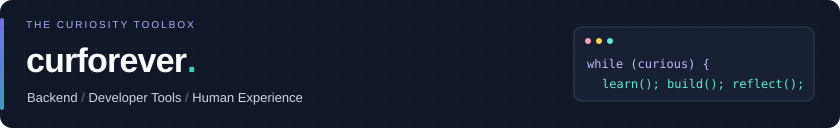
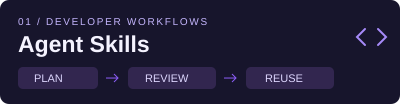
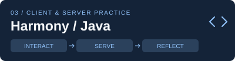
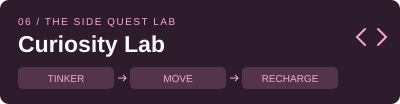
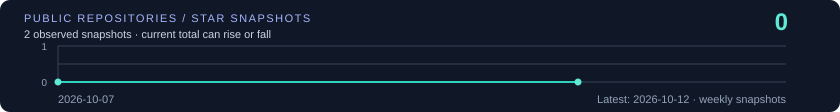

<a href="README.md">简体中文</a> · <b>English</b>

**Hi, I'm curforever 👋** · Hands-on experience with Harmony clients and Java services; interested in performance optimization and human–computer interaction.

I like breaking complex problems into testable pieces and turning repeated work into useful tools. This toolbox connects client/server practice, VR research, AI tools, writing and open-source contributions.

 

[🏆 Practice](#user-content-work) · [🧰 Stack](#user-content-stack) · [📦 Public projects](#user-content-projects) · [📚 Beyond code](#user-content-beyond) · [🎓 Experience](#user-content-experience) · [💬 Contact](#user-content-contact)

## 🏆 Selected projects & practice

<table>
<tr>
<td width="50%" valign="top">

<b>Agent Skills · Organize once, reuse often</b> 
A maintained collection of skills for development, learning, communication and project handoffs. Keep useful methods discoverable and give AI agents clearer task boundaries.  
<code>Organization</code> <code>Code reading</code> <code>Handoffs</code>  
<a href="https://github.com/curforever/curforever-skills/tree/main/skills/development/code-reading-coach">Code-reading example →</a> · <a href="https://github.com/curforever/curforever-skills">Skill directory →</a>
</td>
<td width="50%" valign="top">

<b>Graduate research · Perception to edge collaboration</b> 
From current user tasks to shared scene content: connect task-aware rendering, cache reuse and client–edge communication. Original thesis figures explain methods, results and limits.  
<code>Task awareness</code> <code>Cache reuse</code> <code>Integration</code>  
<a href="https://curforever.github.io/research/">Visual overview →</a> · <a href="research/README.en.md">Figures & results →</a>
</td>
</tr>
<tr>
<td width="50%" valign="top">

<b>Client & server · Hands-on, still learning</b> 
Client-side interaction and server-side business flows: health check-in state consistency, Java validation and concurrency control, with lessons from debugging and delivery.  
<code>ArkTS / ArkUI</code> <code>Java</code> <code>Delivery</code>  
<a href="https://curforever.github.io/notes/harmony-state-consistency/">State consistency notes →</a> · <a href="#user-content-experience">Experience & lessons →</a>
</td>
<td width="50%" valign="top">

<b>Notebook · Turn input into useful output</b> 
Harmony state consistency, Java latency investigation and VR quality/cache trade-offs. Capture evidence and boundaries; preserve older reading and podcast notes in the archive.  
<code>Technical notes</code> <code>Reading</code> <code>Reflection</code>  
<a href="https://curforever.github.io/notes/java-latency-investigation/">Latency investigation →</a> · <a href="https://curforever.github.io/">Notebook →</a>
</td>
</tr>
<tr>
<td width="50%" valign="top">

<!-- PUBLIC_CONTRIBUTIONS_START -->
<b>Contributions · Send patches upstream</b> 
10 verified merged PRs across 7 public projects. Changes and merge dates are recorded with direct links.  
<code>Public PRs</code> <code>Merge evidence</code> <code>10 PRs merged</code>  
<a href="https://github.com/chandra447/pi-hermes-memory/pull/306">Latest merged PR →</a> · <a href="contributions/README.en.md">Contribution record →</a>
<!-- PUBLIC_CONTRIBUTIONS_END -->
</td>
<td width="50%" valign="top">

<b>Curiosity lab · Hardware feel to UI details</b> 
Custom mechanical keyboards for feel and selection; CSS experiments for visual expression. Explore the everyday details of tools and interfaces.  
<code>Keyboards</code> <code>CSS</code> <code>Interfaces</code>  
<a href="https://github.com/curforever/Keyboard">Keyboard notes →</a> · <a href="https://github.com/curforever/CSSLearning">CSS experiments →</a>
</td>
</tr>
</table>

## 🧰 Toolbox · Client, server, performance & interaction

| Direction | Tools & technologies | Questions I explore |
| :--- | :--- | :--- |
| **Client development** |    | Declarative UI, reusable components, state management and on-device debugging |
| **Server development** |     | IoC / DI, AOP, business validation, scheduled tasks and idempotent retries |
| **Data & distributed systems** |    | Indexes, transactions, cache consistency, messaging, sharding and lock granularity |
| **Performance** |    | Slow-query analysis, execution plans, concurrency, cache reuse and rendering cost |
| **HCI research** |    | Eye-movement task awareness, foveated rendering, shared views and edge collaboration |
| **Engineering foundations** |    | Source reading, reusable AI workflows, knowledge capture, networking and I/O |

## 📦 Project index · Public repositories with context

<!-- PUBLIC_PROJECTS_START -->
| Project | Stars | Forks | Purpose & context |
| :--- | :---: | :---: | :--- |
| [curforever-skills](https://github.com/curforever/curforever-skills) |  |  | Development, learning &amp; project skills |
| [curforever.github.io](https://github.com/curforever/curforever.github.io) |  |  | Engineering, research &amp; reading notes |
| [Keyboard](https://github.com/curforever/Keyboard) |  |  | Switch photos, feel &amp; selection notes |
| [CSSLearning](https://github.com/curforever/CSSLearning) |  |  | CSS learning &amp; interface experiments |
| [any-agent](https://github.com/curforever/any-agent) |  |  | Fork · A single interface to use and evaluate different agent frameworks  |
| [claude-code-from-scratch](https://github.com/curforever/claude-code-from-scratch) |  |  | Fork · Build your own Claude Code from scratch.  🔍 Claude Code 开源了 50 万行代码，读不动？用 ~5000 行 TypeScript / Python 从零复现核心架构，11 章分步教程带你理解 coding agent 精髓 |
| [context-propagation](https://github.com/curforever/context-propagation) |  |  | Fork · Context Propagation API |
| [curiosity-library](https://github.com/curforever/curiosity-library) |  |  | 好奇心书架：个人创作与 AI 协作作品集。 |
| [djl](https://github.com/curforever/djl) |  |  | Fork · An Engine-Agnostic Deep Learning Framework in Java |
| [electerm](https://github.com/curforever/electerm) |  |  | Fork · 📻Free and open-sourced terminal/ssh/sftp/ftp/telnet/serialport/RDP/VNC/Spice client(Linux, Mac, Windows, Android, HarmonyOS, iOS) |
| [handlebars.java](https://github.com/curforever/handlebars.java) |  |  | Fork · Logic-less and semantic Mustache templates with Java |
| [jackson-core](https://github.com/curforever/jackson-core) |  |  | Fork · Core part of Jackson that defines Streaming API as well as basic shared abstractions |
| [javaparser](https://github.com/curforever/javaparser) |  |  | Fork · Java 1-25 Parser and Abstract Syntax Tree for Java with advanced analysis functionalities. |
| [jfreechart](https://github.com/curforever/jfreechart) |  |  | Fork · A 2D chart library for Java applications (JavaFX, Swing or server-side). |
| [jgrapht](https://github.com/curforever/jgrapht) |  |  | Fork · Master repository for the JGraphT project |
| [jna](https://github.com/curforever/jna) |  |  | Fork · Java Native Access |
| [joda-time](https://github.com/curforever/joda-time) |  |  | Fork · Joda-Time is the widely used replacement for the Java date and time classes prior to Java SE 8. |
| [json-schema-validator](https://github.com/curforever/json-schema-validator) |  |  | Fork · A fast Java JSON schema validator that supports draft V4, V6, V7, V2019-09 and V2020-12 |
| [JsonPath](https://github.com/curforever/JsonPath) |  |  | Fork · Java JsonPath implementation |
| [leetcode-master](https://github.com/curforever/leetcode-master) |  |  | Fork: Java implementations and documentation fixes |
| [logging-log4j2](https://github.com/curforever/logging-log4j2) |  |  | Fork · Apache Log4j is a versatile, feature-rich, efficient logging API and backend for Java. |
| [mustache.java](https://github.com/curforever/mustache.java) |  |  | Fork · Implementation of mustache.js for Java |
| [pi-hermes-memory](https://github.com/curforever/pi-hermes-memory) |  |  | Fork · Hermes-style persistent memory and learning loop for Pi coding agent |
| [ponytail](https://github.com/curforever/ponytail) |  |  | Fork · Makes your AI agent think like the laziest senior dev in the room. The best code is the code you never wrote. |
| [react-native-cli](https://github.com/curforever/react-native-cli) |  |  | Fork · The React Native Community CLI — Command line tools to help you build React Native apps |
| [resilience4j](https://github.com/curforever/resilience4j) |  |  | Fork · Resilience4j is a fault tolerance library designed for Java8 and functional programming |
| [snappy-java](https://github.com/curforever/snappy-java) |  |  | Fork · Snappy compressor/decompressor for Java |
| [zjsonpatch](https://github.com/curforever/zjsonpatch) |  |  | Fork · This is an implementation of RFC 6902 JSON Patch written in Java |
| [zt-exec](https://github.com/curforever/zt-exec) |  |  | Fork · ZeroTurnaround Process Executor |
| [CangQiongWaiMai-Java](https://github.com/curforever/CangQiongWaiMai-Java) |  |  | Course practice: business, cache &amp; Spring |
| [HexoBlogBackup](https://github.com/curforever/HexoBlogBackup) |  |  | Hexo content, theme &amp; configuration |
| [curforever](https://github.com/curforever/curforever) |  |  | Bilingual profile, assets &amp; metric refresh |
<!-- PUBLIC_PROJECTS_END -->

 · Public repositories only; refreshed weekly. Forks and course projects are labeled.

## 📚 Beyond code · Curiosity needs input

  

| Input channel | How it connects to practice | An example or entry point |
| :--- | :--- | :--- |
| **📖 Reading** | Biographies, organizations and work methods; keep questions and reflections | [The Pragmatic Thinking notebook](https://curforever.github.io/2025/02/09/%E8%AF%BB%E4%B9%A6%E7%AC%94%E8%AE%B0%E3%80%8A%E7%A8%8B%E5%BA%8F%E5%91%98%E7%9A%84%E6%80%9D%E7%BB%B4%E4%BF%AE%E7%82%BC%20%E5%BC%80%E5%8F%91%E8%AE%A4%E7%9F%A5%E6%BD%9C%E8%83%BD%E7%9A%84%E4%B9%9D%E5%A0%82%E8%AF%BE%E3%80%8B/) · Focus, trade-offs and creating value |
| **🎧 Podcasts** | Capture ideas during commutes and revisit useful questions | [Categories](https://curforever.github.io/categories/) · Information quality, cognition and long-term thinking |
| **🌍 English** | Regular vocabulary practice and technical reading | Find answers in English documentation and practice explaining technical ideas clearly |
| **✍️ Writing** | Clarify before starting, record evidence while working, review after delivery | [Notebook](https://curforever.github.io/) · [Code-reading method](https://github.com/curforever/curforever-skills/tree/main/skills/development/code-reading-coach) |
| **🏃 Movement** | Running, basketball and core training for a sustainable rhythm | Keep some interests free of KPIs; energy helps maintain focus |

## 🎓 Experience & outcomes · What I've actually worked on

| Period | Experience | Focus & lessons |
| :--- | :--- | :--- |
| **2023–2026** | **Southeast University · Graduate study in software** | VR, HCI and rendering optimization; methods through system integration |
| **2019–2023** | **Hefei University of Technology · Undergraduate study in computing** | Computing fundamentals, software projects and algorithm competitions |
| **2025.07–09** | **Huawei · Server-side software development internship** | Business validation, scheduled retries and concurrency control; requirements, review and delivery |
| **2025.07** | **HarmonyOS training program · Team project** | Health check-in app, interaction improvements and on-device demos; recognized as an outstanding team member |

| Selected outcome | Details |
| :--- | :--- |
| **🥽 Publication** | First-author CSCWD 2025 paper on virtual companions and multi-user VR cinema experience |
| **🏅 Scholarships & recognition** | National-level scholarship; outstanding graduate student at SEU; outstanding graduate at HFUT |
| **💻 Technical competitions** | China Software Cup national third prize (team library-management project); provincial second prizes in mathematical modeling and the Lanqiao Cup |
| **🌍 Language & communication** | NECCS Category C second prize; Find answers in English documentation and practice explaining technical ideas clearly |
| **🤝 Practice & sharing** | Outstanding theory/practice teams and individual recognition in HarmonyOS training; community-contributor recognition during the internship |

## ⭐ Open-source progress · Useful things take time

Current total stars across public, non-fork repositories, sampled weekly. The first real snapshot starts the series; subsequent snapshots form the trend.

## 💬 Ideas, feedback or collaboration? Let's talk

Leave a note in [Issues](https://github.com/curforever/curforever/issues) to discuss technology, improve a tool or build something interesting together.

## 🛠️ Keep the toolbox growing. Occasionally build a wheel—and make it turn.
